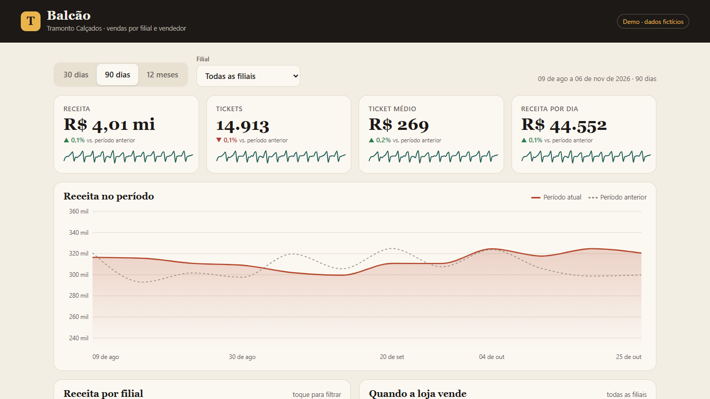
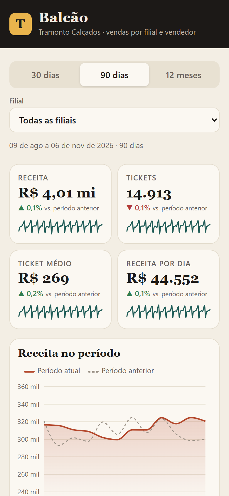

# Balcão — in-store sales by branch and salesperson

A dashboard for a fictional footwear retailer, **Tramonto Calçados** (6 branches, 28 salespeople).
It answers the questions a store manager asks every morning: how are we doing against the previous period, which branch carries the week, when does the floor get busy, and who is on target.

**Live demo:** https://alissonlittig.github.io/balcao-dashboard/

> Demo project. The brand, branches and people are made up, and every number is generated by a seeded script (`npm run data`). Nothing here describes a real business.

| Desktop | Mobile (390 px) |
|---|---|
|  |  |

## What it shows
- Revenue, tickets, average ticket and revenue per day, each with change versus the previous period and a sparkline.
- Revenue line chart (daily for 30 days, weekly for 90 days / 12 months) overlaid with the previous period.
- Revenue by branch; click a bar (or use the select) to filter the whole page.
- Weekday x hour heat map of when sales happen (shopping-mall branches trade until 22h).
- Salesperson ranking with attainment against a per-person target.

## Stack
Plain JavaScript + **D3** for every chart (no chart library), Vite, Vitest. The aggregation logic is in `src/dados.js` as pure functions with unit tests; rendering is in `src/main.js`. Data lives in `public/dados.json`.

## Run
```bash
npm install
npm run data    # regenerate the synthetic dataset (deterministic seed)
npm run dev
npm test
npm run build
```

CI (`.github/workflows/pages.yml`) runs tests and the build on every push and deploys `dist` to GitHub Pages from `main`.

## Data model
`rows` = `[date, salespersonId, tickets, revenue]` per salesperson per day, 730 days. Attainment = revenue / (daily target x days in period).

License: MIT
